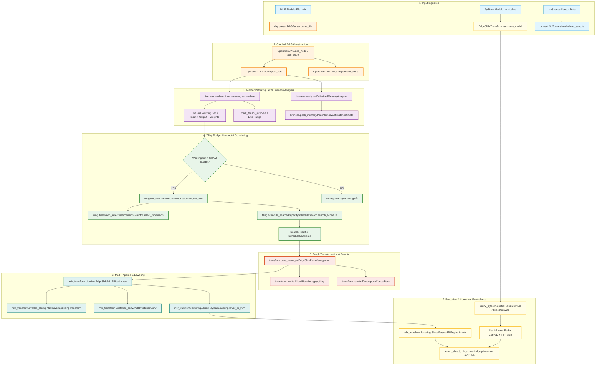
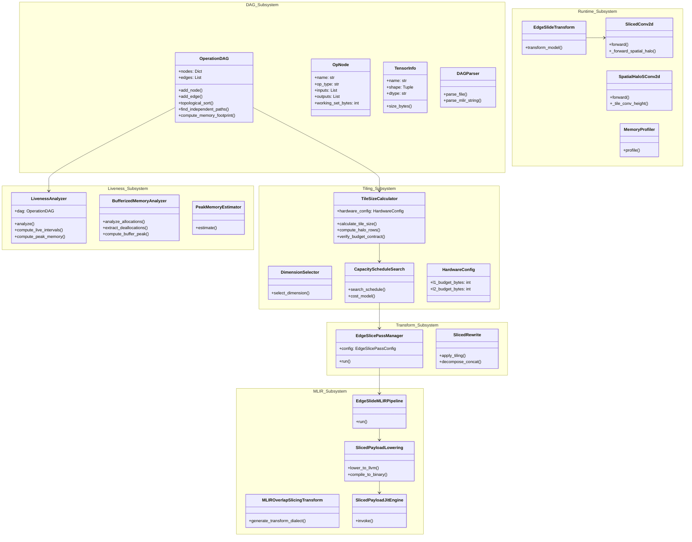

# EdgeSlide: Toàn Bộ Kiến Trúc Flowchart, Component & Package Diagram

> **Mục tiêu tài liệu:** Bản vẽ thiết kế kiến trúc toàn diện cho dự án **EdgeSlide** (`C:\Users\Administrator\Downloads\edge_slide\src\edgeslide`).
> Tài liệu gồm 3 phần chính:
> 1. **End-to-End System Pipeline Flowchart** (Sơ đồ khối luồng dữ liệu xuyên suốt từ Input đến JIT Output).
> 2. **Component & Package Diagram** (Sơ đồ lớp và các Package thành phần chuẩn Mermaid).
> 3. **Bảng tra cứu 100% tất cả các Class, Hàm và Method** (toàn bộ 359 biểu tượng lập trình có trong mã nguồn).

---

## PHẦN 1: END-TO-END PIPELINE FLOWCHART

Biểu đồ luồng thực thi toàn trình của EdgeSlide từ lúc nạp mô hình mạng nơ-ron đến khi phân tích bộ nhớ, cắt lát Tile và thực thi JIT:

---

## PHẦN 2: COMPONENT & PACKAGE DIAGRAM

Sơ đồ cấu trúc gói (Package Diagram) và các thành phần (Component Diagram) thể hiện sự phụ thuộc giữa các lớp:

---

## PHẦN 3: DANH MỤC CHI TIẾT TOÀN BỘ 100% CÁC CLASS, HÀM & METHOD

Bảng tra cứu chi tiết toàn bộ các module và hàm chức năng:

### Module: `edgeslide/dag/graph.py`

| Loai | Ten Class / Ham | Tham so va Kieu tra ve | Dong | Vai tro kien truc |
|---|---|---|---|---|
| **CLASS** | **`TensorInfo`** | `10` | L | Dinh nghia Lop kien truc trong he thong |
| Method (`TensorInfo`) | `resolved_shape` | `self  -> Tuple[int, ...]` | L31 | Phuong thuc thuc thi |
| Method (`TensorInfo`) | `element_size_bytes` | `self  -> int` | L53 | Phuong thuc thuc thi |
| Method (`TensorInfo`) | `size_bytes` | `self  -> int` | L59 | Phuong thuc thuc thi |
| Method (`TensorInfo`) | `_resolve_dynamic_dim` | `self, index: int  -> int` | L63 | Phuong thuc thuc thi |
| Method (`TensorInfo`) | `_display_name` | `self  -> str` | L78 | Phuong thuc thuc thi |
| **CLASS** | **`OpNode`** | `83` | L | Dinh nghia Lop kien truc trong he thong |
| Method (`OpNode`) | `__post_init__` | `self  -> None` | L93 | Phuong thuc thuc thi |
| Method (`OpNode`) | `has_single_output` | `self  -> bool` | L98 | Phuong thuc thuc thi |
| **CLASS** | **`OperationDAG`** | `102` | L | Dinh nghia Lop kien truc trong he thong |
| Method (`OperationDAG`) | `__init__` | `self` | L105 | Khoi tao doi tuong OperationDAG |
| Method (`OperationDAG`) | `add_edge` | `self, producer_id: int, consumer_id: int` | L132 | Phuong thuc thuc thi |
| Method (`OperationDAG`) | `topological_order` | `self  -> List[int]` | L137 | Phuong thuc thuc thi |

### Module: `edgeslide/dag/parser.py`

| Loai | Ten Class / Ham | Tham so va Kieu tra ve | Dong | Vai tro kien truc |
|---|---|---|---|---|
| **CLASS** | **`MLIRContextError`** | `51` | L | Dinh nghia Lop kien truc trong he thong |
| **CLASS** | **`MLIRTraversalError`** | `56` | L | Dinh nghia Lop kien truc trong he thong |
| **CLASS** | **`DAGParser`** | `61` | L | Dinh nghia Lop kien truc trong he thong |
| Method (`DAGParser`) | `__init__` | `self, model: "torch.nn.Module", example_input: "torch.Ten...` | L71 | Khoi tao doi tuong DAGParser |
| Method (`DAGParser`) | `parse` | `self  -> OperationDAG` | L81 | Phan tich cu phap trung gian MLIR/PyTorch |
| Method (`DAGParser`) | `_compile_to_linalg` | `model: "torch.nn.Module", example_input: "torch.Tensor"` | L117 | Phuong thuc thuc thi |
| Method (`DAGParser`) | `edgeslice_op_tag` | `op_id: int  -> str` | L163 | Phuong thuc thuc thi |
| Method (`DAGParser`) | `save_mlir` | `self, path: str  -> str` | L167 | Phuong thuc thuc thi |
| Method (`DAGParser`) | `_build_dag_native` | `self, mlir_module  -> OperationDAG` | L175 | Phuong thuc thuc thi |
| Method (`DAGParser`) | `_walk_module` | `self, mlir_module, dag: OperationDAG` | L202 | Phuong thuc thuc thi |
| Method (`DAGParser`) | `_walk_block` | `self, block, dag: OperationDAG` | L210 | Phuong thuc thuc thi |
| Method (`DAGParser`) | `_process_operation` | `self, op, dag: OperationDAG` | L216 | Phuong thuc thuc thi |
| Method (`DAGParser`) | `_get_op_type` | `self, op_name: str  -> str` | L246 | Phuong thuc thuc thi |
| Method (`DAGParser`) | `_process_linalg_op` | `self, op, op_type: str, dag: OperationDAG` | L251 | Phuong thuc thuc thi |
| Method (`DAGParser`) | `_process_arith_tensor_op` | `self, op, op_type: str, dag: OperationDAG` | L301 | Phuong thuc thuc thi |
| Method (`DAGParser`) | `_get_or_create_tensor_info` | `self, ssa_value  -> Optional[TensorInfo]` | L341 | Phuong thuc thuc thi |
| Method (`DAGParser`) | `_create_tensor_info_from_type` | `self, mlir_type, ssa_value  -> Optional[TensorInfo]` | L354 | Phuong thuc thuc thi |
| Method (`DAGParser`) | `_annotate_mlir_op` | `self, op, tag: str  -> None` | L397 | Phuong thuc thuc thi |
| Method (`DAGParser`) | `_is_elementwise_identity_generic` | `op  -> bool` | L409 | Phuong thuc thuc thi |
| Method (`DAGParser`) | `parts` | `text_` | L460 | Phuong thuc thuc thi |
| Method (`DAGParser`) | `_extract_op_attributes` | `self, op  -> Dict[str, Any]` | L482 | Phuong thuc thuc thi |
| Method (`DAGParser`) | `_parse_attribute_value` | `self, attr_value  -> Any` | L532 | Phuong thuc thuc thi |
| Method (`DAGParser`) | `_connect_edges_using_producer_map` | `self, dag: OperationDAG` | L577 | Phuong thuc thuc thi |
| Method (`DAGParser`) | `parse_pytorch_model` | `model: "torch.nn.Module", example_input: "torch.Tensor"  ...` | L594 | Phan tich cu phap trung gian MLIR/PyTorch |
| Function | `_extract_state_dict` | `obj: Any  -> Optional[Mapping[str, Any]]` | L717 | Phuong thuc thuc thi |

### Module: `edgeslide/liveness/analyzer.py`

| Loai | Ten Class / Ham | Tham so va Kieu tra ve | Dong | Vai tro kien truc |
|---|---|---|---|---|
| **CLASS** | **`InferredSizeRefused`** | `29` | L | Dinh nghia Lop kien truc trong he thong |
| **CLASS** | **`MemRefAllocation`** | `38` | L | Dinh nghia Lop kien truc trong he thong |
| Method (`MemRefAllocation`) | `region_depth` | `self  -> int` | L60 | Phuong thuc thuc thi |
| Method (`MemRefAllocation`) | `enclosing_loops` | `self  -> Tuple[str, ...]` | L65 | Phuong thuc thuc thi |
| Method (`MemRefAllocation`) | `inside_loop` | `self  -> bool` | L70 | Phuong thuc thuc thi |
| Method (`MemRefAllocation`) | `has_dynamic_extent` | `self  -> bool` | L75 | Phuong thuc thuc thi |
| Method (`MemRefAllocation`) | `hoistable` | `self  -> bool` | L85 | Phuong thuc thuc thi |
| Method (`MemRefAllocation`) | `accumulates_across_iterations` | `self  -> bool` | L98 | Phuong thuc thuc thi |
| **CLASS** | **`MemRefCopy`** | `126` | L | Dinh nghia Lop kien truc trong he thong |
| Method (`MemRefCopy`) | `inside_loop` | `self  -> bool` | L142 | Phuong thuc thuc thi |
| **CLASS** | **`BufferizedMemoryReport`** | `147` | L | Dinh nghia Lop kien truc trong he thong |
| Method (`BufferizedMemoryReport`) | `allocation_attribution` | `self  -> List[Dict[str, Any]]` | L165 | Phuong thuc thuc thi |
| Method (`BufferizedMemoryReport`) | `attribution_totals` | `self  -> Dict[str, Any]` | L197 | Phuong thuc thuc thi |
| Method (`BufferizedMemoryReport`) | `get_peak` | `self  -> Tuple[int, int]` | L246 | Phuong thuc thuc thi |
| Method (`BufferizedMemoryReport`) | `get_peak_last_use` | `self  -> Tuple[int, int]` | L252 | Phuong thuc thuc thi |
| Method (`BufferizedMemoryReport`) | `find_mlir_opt` | `-> Optional[str]` | L260 | Phuong thuc thuc thi |
| Function | `_scan_braces` | `line: str  -> Tuple[int, int]` | L381 | Phuong thuc thuc thi |
| Function | `_region_op_name` | `line: str  -> str` | L423 | Phuong thuc thuc thi |
| Function | `_region_stacks` | `operation_lines  -> Dict[int, Tuple[str, ...]]` | L430 | Phuong thuc thuc thi |
| Function | `_loop_exit_indices` | `operation_lines  -> Dict[int, int]` | L450 | Phuong thuc thuc thi |
| Function | `_forall_induction_domains` | `operation_lines  -> Dict[str, List[Tuple[int, int]]]` | L542 | Phuong thuc thuc thi |
| Function | `_affine_eval` | `expr: str, value: int  -> Optional[int]` | L569 | Phuong thuc thuc thi |
| Function | `_attained_min_maximum` | `results: List[str], extent: int  -> Optional[int]` | L604 | Phuong thuc thuc thi |
| Function | `latest` | `name: str, before: int  -> Optional[int]` | L662 | Phuong thuc thuc thi |
| Function | `domain_of` | `line: str, before: int  -> Optional[int]` | L666 | Phuong thuc thuc thi |
| Function | `_split_affine_results` | `results: str  -> List[str]` | L744 | Phuong thuc thuc thi |
| Function | `_region_scoped_definitions` | `operation_lines` | L762 | Phuong thuc thuc thi |
| Function | `_alias_roots` | `operation_lines, definitions, roots` | L807 | Phuong thuc thuc thi |
| **CLASS** | **`BufferizedMemoryAnalyzer`** | `834` | L | Dinh nghia Lop kien truc trong he thong |
| Method (`BufferizedMemoryAnalyzer`) | `analyze` | `self  -> BufferizedMemoryReport` | L926 | Phan tich liveness va bo nho Working Set |
| Method (`BufferizedMemoryAnalyzer`) | `_collect_constant_globals` | `operation_lines  -> Tuple[int, int]` | L947 | Phuong thuc thuc thi |
| Method (`BufferizedMemoryAnalyzer`) | `_collect_copies` | `operation_lines  -> List[MemRefCopy]` | L966 | Phuong thuc thuc thi |
| Method (`BufferizedMemoryAnalyzer`) | `estimate` | `self  -> Dict[int, int]` | L984 | Phuong thuc thuc thi |
| Method (`BufferizedMemoryAnalyzer`) | `get_peak` | `self  -> Tuple[int, int]` | L988 | Phuong thuc thuc thi |
| Method (`BufferizedMemoryAnalyzer`) | `get_peak_last_use` | `self  -> Tuple[int, int]` | L991 | Phuong thuc thuc thi |
| Method (`BufferizedMemoryAnalyzer`) | `_collect_allocations` | `self  -> List[MemRefAllocation]` | L995 | Phuong thuc thuc thi |
| Method (`BufferizedMemoryAnalyzer`) | `_operation_lines` | `self  -> List[Tuple[int, str]]` | L1162 | Phuong thuc thuc thi |
| Method (`BufferizedMemoryAnalyzer`) | `summary` | `self  -> str` | L1194 | Phuong thuc thuc thi |
| Method (`BufferizedMemoryAnalyzer`) | `_extract_memref_type` | `line: str  -> Optional[str]` | L1232 | Phuong thuc thuc thi |
| Function | `_lookup_dim_bound` | `bounds: Mapping[Union[int, str], Any], index: int  -> Opt...` | L1323 | Phuong thuc thuc thi |
| **CLASS** | **`LivenessAnalyzer`** | `1333` | L | Dinh nghia Lop kien truc trong he thong |
| Method (`LivenessAnalyzer`) | `__init__` | `self, dag: OperationDAG` | L1340 | Khoi tao doi tuong LivenessAnalyzer |
| Method (`LivenessAnalyzer`) | `_dag_fingerprint` | `self  -> Tuple[Any, ...]` | L1346 | Phuong thuc thuc thi |
| Method (`LivenessAnalyzer`) | `analyze` | `self  -> Dict[int, Set[int]]` | L1379 | Phan tich liveness va bo nho Working Set |
| Method (`LivenessAnalyzer`) | `get_live_range` | `self, tensor_idx: int  -> Tuple[int, int]` | L1458 | Phuong thuc thuc thi |
| Method (`LivenessAnalyzer`) | `get_live_tensors` | `self, op_id: int  -> Set[int]` | L1462 | Phuong thuc thuc thi |
| Method (`LivenessAnalyzer`) | `summary` | `self  -> str` | L1466 | Phuong thuc thuc thi |
| Function | `summarize_memory_tiers` | `mlir_text: str  -> Dict[str, Any]` | L1488 | Phuong thuc thuc thi |
| Function | `format_memory_tier_report` | `mlir_text: str  -> str` | L1520 | Phuong thuc thuc thi |

### Module: `edgeslide/liveness/peak_memory.py`

| Loai | Ten Class / Ham | Tham so va Kieu tra ve | Dong | Vai tro kien truc |
|---|---|---|---|---|
| Function | `_is_destination_passing` | `op_type: str  -> bool` | L13 | Phuong thuc thuc thi |
| **CLASS** | **`BufferizedPeakMemoryEstimator`** | `26` | L | Dinh nghia Lop kien truc trong he thong |
| Method (`BufferizedPeakMemoryEstimator`) | `estimate` | `self  -> Dict[int, int]` | L76 | Phuong thuc thuc thi |
| Method (`BufferizedPeakMemoryEstimator`) | `get_peak` | `self  -> tuple` | L79 | Phuong thuc thuc thi |
| Method (`BufferizedPeakMemoryEstimator`) | `summary` | `self  -> str` | L82 | Phuong thuc thuc thi |
| **CLASS** | **`PeakMemoryEstimator`** | `86` | L | Dinh nghia Lop kien truc trong he thong |
| Method (`PeakMemoryEstimator`) | `__init__` | `self, dag: OperationDAG, l1_cache_bytes: int = 512 * 1024` | L93 | Khoi tao doi tuong PeakMemoryEstimator |
| Method (`PeakMemoryEstimator`) | `_fingerprint` | `self  -> tuple` | L100 | Phuong thuc thuc thi |
| Method (`PeakMemoryEstimator`) | `estimate` | `self  -> Dict[int, int]` | L121 | Phuong thuc thuc thi |
| Method (`PeakMemoryEstimator`) | `get_peak` | `self  -> tuple` | L219 | Phuong thuc thuc thi |
| Method (`PeakMemoryEstimator`) | `exceeds_l1` | `self  -> List[int]` | L226 | Phuong thuc thuc thi |
| Method (`PeakMemoryEstimator`) | `slicing_candidates` | `self  -> List[dict]` | L230 | Phuong thuc thuc thi |
| Method (`PeakMemoryEstimator`) | `summary` | `self  -> str` | L250 | Phuong thuc thuc thi |
| Method (`PeakMemoryEstimator`) | `find` | `x: int  -> int` | L304 | Phuong thuc thuc thi |
| Method (`PeakMemoryEstimator`) | `union` | `a: int, b: int  -> None` | L311 | Phuong thuc thuc thi |
| Method (`PeakMemoryEstimator`) | `_build_tensor_map` | `self  -> Dict[int, TensorInfo]` | L370 | Phuong thuc thuc thi |

### Module: `edgeslide/tiling/tile_size.py`

| Loai | Ten Class / Ham | Tham so va Kieu tra ve | Dong | Vai tro kien truc |
|---|---|---|---|---|
| **CLASS** | **`TileBudgetError`** | `12` | L | Dinh nghia Lop kien truc trong he thong |
| Method (`TileBudgetError`) | `_pair_tuple` | `value: Any  -> Tuple[int, int]` | L16 | Phuong thuc thuc thi |
| Method (`TileBudgetError`) | `node_cost_kwargs` | `node: Any  -> Dict[str, Any]` | L25 | Phuong thuc thuc thi |
| **CLASS** | **`HardwareConfig`** | `79` | L | Dinh nghia Lop kien truc trong he thong |
| Method (`HardwareConfig`) | `l1_budget_bytes` | `self  -> int` | L115 | Phuong thuc thuc thi |
| Method (`HardwareConfig`) | `l2_budget_bytes` | `self  -> Optional[int]` | L119 | Phuong thuc thuc thi |
| Method (`HardwareConfig`) | `budget_levels` | `self  -> List[Tuple[str, int]]` | L124 | Phuong thuc thuc thi |
| Method (`HardwareConfig`) | `for_device` | `cls, device: str, **overrides: Any  -> "HardwareConfig"` | L168 | Phuong thuc thuc thi |
| **CLASS** | **`TileFootprint`** | `212` | L | Dinh nghia Lop kien truc trong he thong |
| **CLASS** | **`TileDecision`** | `228` | L | Dinh nghia Lop kien truc trong he thong |
| **CLASS** | **`TileSizeCalculator`** | `253` | L | Dinh nghia Lop kien truc trong he thong |
| Method (`TileSizeCalculator`) | `footprint` | `p_tile: int, s_tile: int  -> int` | L437 | Phuong thuc thuc thi |
| Method (`TileSizeCalculator`) | `search` | `upper: int, fits: Callable[[int], int]  -> int` | L460 | Tim kiem lich trinh cat lat toi uu (Schedule Search) |
| Method (`TileSizeCalculator`) | `_full_extent` | `self, shape: Tuple[int, ...], slice_dim: str, op_type: st...` | L894 | Phuong thuc thuc thi |
| Method (`TileSizeCalculator`) | `budget_bytes` | `self  -> int` | L1103 | Phuong thuc thuc thi |
| Method (`TileSizeCalculator`) | `l1_budget_bytes` | `self  -> int` | L1116 | Phuong thuc thuc thi |
| Method (`TileSizeCalculator`) | `budget_utilization` | `self, footprint_bytes: int  -> float` | L1120 | Phuong thuc thuc thi |
| Method (`TileSizeCalculator`) | `_fits_cache_budget` | `self, bytes_required: int  -> bool` | L1130 | Phuong thuc thuc thi |
| Method (`TileSizeCalculator`) | `binding_level_name` | `self, bytes_required: int  -> str` | L1145 | Phuong thuc thuc thi |
| Method (`TileSizeCalculator`) | `_binding_level` | `self, bytes_required: int  -> Tuple[str, int]` | L1154 | Phuong thuc thuc thi |
| Method (`TileSizeCalculator`) | `_aligned_bytes` | `self, elements: int, dtype_size: int  -> int` | L1167 | Phuong thuc thuc thi |
| Method (`TileSizeCalculator`) | `_align_up` | `value: int, alignment: int  -> int` | L1172 | Phuong thuc thuc thi |
| Method (`TileSizeCalculator`) | `_align_tile_to_vector` | `self, tile_size: int, slice_dim: str, dtype_size: int  ->...` | L1177 | Phuong thuc thuc thi |
| Method (`TileSizeCalculator`) | `_dim_name_to_index` | `name: str, shape: Tuple[int, ...], op_type: str = ""  -> int` | L1186 | Phuong thuc thuc thi |
| Method (`TileSizeCalculator`) | `_round_down_to_granule` | `self, tile_size: int, dtype_size: int  -> int` | L1189 | Phuong thuc thuc thi |
| Method (`TileSizeCalculator`) | `_tile_granule` | `self, dtype_size: int  -> int` | L1214 | Phuong thuc thuc thi |

### Module: `edgeslide/tiling/dimension_selector.py`

| Loai | Ten Class / Ham | Tham so va Kieu tra ve | Dong | Vai tro kien truc |
|---|---|---|---|---|
| **CLASS** | **`DimensionSelector`** | `16` | L | Dinh nghia Lop kien truc trong he thong |
| Method (`DimensionSelector`) | `__init__` | `self, dag: OperationDAG` | L38 | Khoi tao doi tuong DimensionSelector |
| Method (`DimensionSelector`) | `select` | `self, op_id: int  -> str` | L41 | Lua chon chieu cat khong gian H/W/C |
| Method (`DimensionSelector`) | `rank` | `self, op_id: int  -> list` | L49 | Phuong thuc thuc thi |
| Method (`DimensionSelector`) | `rank_pairs` | `self, op_id: int  -> List[Tuple[str, str]]` | L60 | Phuong thuc thuc thi |
| Method (`DimensionSelector`) | `select_all` | `self  -> dict` | L80 | Lua chon chieu cat khong gian H/W/C |
| Method (`DimensionSelector`) | `_normalize_op_type` | `op_type: str  -> str` | L85 | Phuong thuc thuc thi |
| Method (`DimensionSelector`) | `is_nhwc_op` | `op_type: str  -> bool` | L107 | Phuong thuc thuc thi |
| Method (`DimensionSelector`) | `is_depthwise_op` | `op_type: str  -> bool` | L111 | Phuong thuc thuc thi |
| Method (`DimensionSelector`) | `dimension_indices` | `op_type: str, rank: int  -> dict[str, int]` | L123 | Phuong thuc thuc thi |
| Method (`DimensionSelector`) | `dimension_name_to_index` | `name: str, op_type: str, rank: int  -> int` | L137 | Phuong thuc thuc thi |
| Method (`DimensionSelector`) | `rank_dimension_indices` | `shape: Tuple[int, ...], op_type: str  -> List[int]` | L152 | Phuong thuc thuc thi |
| Method (`DimensionSelector`) | `push` | `index: Optional[int]  -> None` | L168 | Phuong thuc thuc thi |
| Function | `select_dimension_index` | `shape: Tuple[int, ...], op_type: str  -> int` | L242 | Lua chon chieu cat khong gian H/W/C |
| Function | `dimension_index_to_name` | `idx: int, op_type: str, rank: int  -> str` | L252 | Phuong thuc thuc thi |
| Function | `select_dimension_name` | `shape: Tuple[int, ...], op_type: str  -> str` | L260 | Lua chon chieu cat khong gian H/W/C |

### Module: `edgeslide/tiling/schedule_search.py`

| Loai | Ten Class / Ham | Tham so va Kieu tra ve | Dong | Vai tro kien truc |
|---|---|---|---|---|
| **CLASS** | **`ScheduleCandidate`** | `38` | L | Dinh nghia Lop kien truc trong he thong |
| Method (`ScheduleCandidate`) | `with_latency` | `self, latency_ms: float  -> "ScheduleCandidate"` | L54 | Phuong thuc thuc thi |
| **CLASS** | **`SearchResult`** | `65` | L | Dinh nghia Lop kien truc trong he thong |
| Function | `_candidate_sizes` | `extent: int, maximum: int, granule: int  -> List[int]` | L75 | Phuong thuc thuc thi |
| **CLASS** | **`CapacityScheduleSearch`** | `97` | L | Dinh nghia Lop kien truc trong he thong |
| Method (`CapacityScheduleSearch`) | `_dimension_name` | `index: int, op_type: str, rank: int  -> str` | L218 | Phuong thuc thuc thi |
| **CLASS** | **`TargetAutotuner`** | `318` | L | Dinh nghia Lop kien truc trong he thong |
| Method (`TargetAutotuner`) | `__call__` | `self, candidate: ScheduleCandidate  -> float` | L339 | Phuong thuc thuc thi |
| Method (`TargetAutotuner`) | `_key` | `self, candidate: ScheduleCandidate  -> str` | L358 | Phuong thuc thuc thi |
| Method (`TargetAutotuner`) | `_load_cache` | `self  -> Dict[str, Dict[str, Any]]` | L368 | Phuong thuc thuc thi |
| Method (`TargetAutotuner`) | `_save_cache` | `self  -> None` | L376 | Phuong thuc thuc thi |

### Module: `edgeslide/transform/pass_manager.py`

| Loai | Ten Class / Ham | Tham so va Kieu tra ve | Dong | Vai tro kien truc |
|---|---|---|---|---|
| **CLASS** | **`EdgeSlicePassConfig`** | `54` | L | Dinh nghia Lop kien truc trong he thong |
| Method (`EdgeSlicePassConfig`) | `tile_calculator` | `self  -> TileSizeCalculator` | L109 | Phuong thuc thuc thi |
| **CLASS** | **`UncostablePlanEntry`** | `143` | L | Dinh nghia Lop kien truc trong he thong |
| **CLASS** | **`EdgeSlicePassManager`** | `251` | L | Dinh nghia Lop kien truc trong he thong |
| Method (`EdgeSlicePassManager`) | `l1_cache_bytes` | `self  -> int` | L286 | Phuong thuc thuc thi |
| Method (`EdgeSlicePassManager`) | `run` | `self, transform_style: str = "structured"  -> PassManager...` | L289 | Phuong thuc thuc thi |
| Method (`EdgeSlicePassManager`) | `_sram_residency_candidates` | `self, memory_at: Dict[int, int]  -> List[dict]` | L393 | Phuong thuc thuc thi |
| Method (`EdgeSlicePassManager`) | `_all_large_tileable_ops` | `self, memory_at: Dict[int, int]  -> List[dict]` | L435 | Phuong thuc thuc thi |
| Method (`EdgeSlicePassManager`) | `_build_rewrite_plan` | `self, candidates: List[dict]  -> RewritePlanList` | L455 | Phuong thuc thuc thi |
| Method (`EdgeSlicePassManager`) | `_annotate_fusion` | `self, rewriter: SlicedRewrite  -> None` | L690 | Phuong thuc thuc thi |
| Method (`EdgeSlicePassManager`) | `_tile_cost_kwargs` | `node  -> Dict[str, Any]` | L792 | Phuong thuc thuc thi |
| Method (`EdgeSlicePassManager`) | `get_report` | `self  -> str` | L796 | Phuong thuc thuc thi |

### Module: `edgeslide/transform/rewrite.py`

| Loai | Ten Class / Ham | Tham so va Kieu tra ve | Dong | Vai tro kien truc |
|---|---|---|---|---|
| Function | `validate_transform_style` | `style: str  -> str` | L153 | Phuong thuc thuc thi |
| **CLASS** | **`SlicedRewrite`** | `160` | L | Dinh nghia Lop kien truc trong he thong |
| Method (`SlicedRewrite`) | `_plan_fusion` | `self  -> None` | L217 | Phuong thuc thuc thi |
| Method (`SlicedRewrite`) | `_absorb_chained_anchors` | `self  -> Set[int]` | L260 | Phuong thuc thuc thi |
| Method (`SlicedRewrite`) | `generate_transform_ir` | `self, style: str = "structured"  -> str` | L287 | Phuong thuc thuc thi |
| Method (`SlicedRewrite`) | `_emit_edgeslice_transform` | `self, plan: RewritePlan  -> List[str]` | L338 | Phuong thuc thuc thi |
| Method (`SlicedRewrite`) | `_is_fusable_node` | `self, op_id: int  -> bool` | L388 | Phuong thuc thuc thi |
| Method (`SlicedRewrite`) | `_is_fusable_producer` | `self, op_id: int  -> bool` | L407 | Phuong thuc thuc thi |
| Method (`SlicedRewrite`) | `_fusion_chain` | `self, anchor_op_id: int  -> List[int]` | L417 | Phuong thuc thuc thi |
| Method (`SlicedRewrite`) | `_fusion_budget_admitter` | `self, anchor_op_id: int  -> Callable[[int], bool]` | L467 | Phuong thuc thuc thi |
| Method (`SlicedRewrite`) | `dim_in` | `node, dim_name: str  -> str` | L492 | Phuong thuc thuc thi |
| Method (`SlicedRewrite`) | `member_bytes` | `node  -> int` | L508 | Phuong thuc thuc thi |
| Method (`SlicedRewrite`) | `admit` | `producer_id: int  -> bool` | L529 | Phuong thuc thuc thi |
| Method (`SlicedRewrite`) | `_emit_fusion` | `self, anchor_op_id: int  -> List[str]` | L547 | Phuong thuc thuc thi |
| Method (`SlicedRewrite`) | `_emit_tier_annotation` | `self, plan: RewritePlan  -> List[str]` | L617 | Phuong thuc thuc thi |
| Method (`SlicedRewrite`) | `_output_bytes` | `self, op_id: int  -> Optional[int]` | L642 | Phuong thuc thuc thi |
| Method (`SlicedRewrite`) | `_emit_dram_annotations` | `self  -> List[str]` | L652 | Phuong thuc thuc thi |
| Method (`SlicedRewrite`) | `_emit_legacy_tile_for` | `self, plan: RewritePlan  -> List[str]` | L689 | Phuong thuc thuc thi |
| Method (`SlicedRewrite`) | `_emit_aggressive_slicing` | `self, plan: RewritePlan  -> List[str]` | L717 | Phuong thuc thuc thi |
| Method (`SlicedRewrite`) | `_op_type_to_mlir` | `self, op_type: str  -> str` | L757 | Phuong thuc thuc thi |
| Method (`SlicedRewrite`) | `_plan_secondary` | `plan: RewritePlan  -> Optional[Tuple[str, int]]` | L826 | Phuong thuc thuc thi |
| Method (`SlicedRewrite`) | `_dim_name_to_index` | `self, dim: str, rank: int, op_type: str  -> int` | L833 | Phuong thuc thuc thi |
| Method (`SlicedRewrite`) | `_shape_to_mlir_type` | `shape: tuple, elem_type: str = "f32"  -> str` | L837 | Phuong thuc thuc thi |

### Module: `edgeslide/mlir_transform/pipeline.py`

| Loai | Ten Class / Ham | Tham so va Kieu tra ve | Dong | Vai tro kien truc |
|---|---|---|---|---|
| Function | `_require_torch` | `-> None` | L51 | Phuong thuc thuc thi |
| Function | `find_mlir_opt` | `-> Optional[str]` | L56 | Phuong thuc thuc thi |
| Function | `require_mlir_opt` | `explicit: Optional[str] = None  -> str` | L69 | Phuong thuc thuc thi |
| Function | `_count_payload_ops` | `mlir_text: str, op_name: str  -> int` | L74 | Phuong thuc thuc thi |
| Function | `merge_payload_and_transform` | `payload_mlir: str, transform_mlir: str  -> str` | L112 | Phuong thuc thuc thi |
| Function | `new_run_id` | `-> str` | L251 | Phuong thuc thuc thi |
| **CLASS** | **`RunContext`** | `257` | L | Dinh nghia Lop kien truc trong he thong |
| Method (`RunContext`) | `directory` | `self  -> Path` | L284 | Phuong thuc thuc thi |
| Method (`RunContext`) | `path` | `self, name: str  -> Path` | L288 | Phuong thuc thuc thi |
| **CLASS** | **`EdgeSlideMLIRConfig`** | `299` | L | Dinh nghia Lop kien truc trong he thong |
| **CLASS** | **`PyTorchToMLIRCompiler`** | `328` | L | Dinh nghia Lop kien truc trong he thong |
| Method (`PyTorchToMLIRCompiler`) | `__init__` | `self, config: EdgeSlideMLIRConfig` | L333 | Khoi tao doi tuong PyTorchToMLIRCompiler |
| Method (`PyTorchToMLIRCompiler`) | `extract_conv_info` | `self, model: nn.Module  -> List[Dict[str, Any]]` | L383 | Phuong thuc thuc thi |
| **CLASS** | **`EdgeSlideTransformPass`** | `413` | L | Dinh nghia Lop kien truc trong he thong |
| Method (`EdgeSlideTransformPass`) | `write_transform_mlir` | `self, transform_ir: str, name: str = "transform.mlir"  ->...` | L472 | Phuong thuc thuc thi |
| **CLASS** | **`MLIRToLLVMCompiler`** | `494` | L | Dinh nghia Lop kien truc trong he thong |
| **CLASS** | **`EdgeSlideMLIRPipeline`** | `615` | L | Dinh nghia Lop kien truc trong he thong |
| Method (`EdgeSlideMLIRPipeline`) | `__init__` | `self, config: Optional[EdgeSlideMLIRConfig] = None` | L626 | Khoi tao doi tuong EdgeSlideMLIRPipeline |
| **CLASS** | **`SimpleConvModel`** | `930` | L | Dinh nghia Lop kien truc trong he thong |
| Method (`SimpleConvModel`) | `__init__` | `self` | L931 | Khoi tao doi tuong SimpleConvModel |
| Method (`SimpleConvModel`) | `forward` | `self, x` | L937 | Truyen xuoi Forward Pass trong mo hinh |

### Module: `edgeslide/mlir_transform/lowering.py`

| Loai | Ten Class / Ham | Tham so va Kieu tra ve | Dong | Vai tro kien truc |
|---|---|---|---|---|
| Function | `refined_deallocation_plugin` | `-> Path` | L224 | Phuong thuc thuc thi |
| Function | `refined_stage1_pipeline` | `passes: Sequence[str]  -> str` | L244 | Phuong thuc thuc thi |
| Function | `_with_deallocation_fallback` | `cmd: List[str]  -> Optional[List[str]]` | L278 | Phuong thuc thuc thi |
| Function | `_stage2_vectorized_passes` | `vector_width: int  -> List[str]` | L364 | Phuong thuc thuc thi |
| Function | `find_mlir_tool` | `name: str  -> Optional[str]` | L419 | Phuong thuc thuc thi |
| Function | `require_mlir_tool` | `name: str, explicit: Optional[str] = None  -> str` | L432 | Phuong thuc thuc thi |
| Function | `strip_transform_dialect` | `mlir_text: str  -> str` | L437 | Phuong thuc thuc thi |
| Function | `_find_function_body_brace` | `mlir_text: str, open_paren_index: int  -> int` | L461 | Phuong thuc thuc thi |
| Function | `flatten_nested_module` | `mlir_text: str  -> str` | L525 | Phuong thuc thuc thi |
| Function | `fold_llvm_mul_constexprs` | `llvm_ir: str  -> str` | L581 | Phuong thuc thuc thi |
| Function | `_fold` | `match: "re.Match[str]"  -> str` | L588 | Phuong thuc thuc thi |
| Function | `payload_needs_concat_decomposition` | `mlir_text: str  -> bool` | L627 | Phuong thuc thuc thi |
| Function | `unwrap_redundant_module` | `mlir_text: str  -> str` | L667 | Phuong thuc thuc thi |
| Function | `_unwrap_one_redundant_module` | `mlir_text: str  -> str` | L686 | Phuong thuc thuc thi |
| Function | `_module_extent` | `open_index: int  -> Optional[int]` | L709 | Phuong thuc thuc thi |
| Function | `_opens_module` | `line: str  -> bool` | L718 | Phuong thuc thuc thi |
| Function | `build_runner_shared_lib` | `output_dir: Union[str, Path]  -> str` | L766 | Phuong thuc thuc thi |
| **CLASS** | **`LoweringArtifacts`** | `806` | L | Dinh nghia Lop kien truc trong he thong |
| **CLASS** | **`SlicedPayloadLoweringConfig`** | `815` | L | Dinh nghia Lop kien truc trong he thong |
| Method (`SlicedPayloadLoweringConfig`) | `stage1_passes` | `self  -> List[str]` | L866 | Phuong thuc thuc thi |
| Method (`SlicedPayloadLoweringConfig`) | `all_passes` | `self  -> List[str]` | L875 | Phuong thuc thuc thi |
| **CLASS** | **`SlicedPayloadLowering`** | `910` | L | Dinh nghia Lop kien truc trong he thong |
| Method (`SlicedPayloadLowering`) | `__init__` | `self, config: Optional[SlicedPayloadLoweringConfig] = None` | L913 | Khoi tao doi tuong SlicedPayloadLowering |
| Method (`SlicedPayloadLowering`) | `lower` | `self, sliced_payload_path: str  -> LoweringArtifacts` | L918 | Ha cap ma nguon xuong LLVM IR va Binary JIT |
| Method (`SlicedPayloadLowering`) | `_run_stage1` | `self, mlir_opt: str, prepared_path: Path  -> str` | L1066 | Phuong thuc thuc thi |
| Method (`SlicedPayloadLowering`) | `lower_via_bindings` | `self, sliced_payload_path: str` | L1179 | Ha cap ma nguon xuong LLVM IR va Binary JIT |
| Function | `_init_llvmlite` | `` | L1203 | Phuong thuc thuc thi |
| **CLASS** | **`_ExecutionEngineShim`** | `1230` | L | Dinh nghia Lop kien truc trong he thong |
| Method (`_ExecutionEngineShim`) | `__init__` | `self, jit: "SlicedPayloadJitEngine"` | L1233 | Khoi tao doi tuong _ExecutionEngineShim |
| Method (`_ExecutionEngineShim`) | `raw_lookup` | `self, name: str  -> int` | L1236 | Phuong thuc thuc thi |
| **CLASS** | **`SlicedPayloadJitEngine`** | `1240` | L | Dinh nghia Lop kien truc trong he thong |
| Method (`SlicedPayloadJitEngine`) | `_lookup_symbol` | `self, symbol: str  -> int` | L1282 | Phuong thuc thuc thi |
| Method (`SlicedPayloadJitEngine`) | `_ciface_func_type` | `num_args: int` | L1287 | Phuong thuc thuc thi |
| Method (`SlicedPayloadJitEngine`) | `_get_ciface_func` | `self, symbol: str, num_args: int` | L1295 | Phuong thuc thuc thi |
| Method (`SlicedPayloadJitEngine`) | `__del__` | `self` | L1362 | Phuong thuc thuc thi |
| Method (`SlicedPayloadJitEngine`) | `_torch_dtype_to_ctype` | `dtype` | L1371 | Phuong thuc thuc thi |
| Method (`SlicedPayloadJitEngine`) | `_tensor_to_memref` | `self, tensor  -> ctypes.Structure` | L1384 | Phuong thuc thuc thi |
| Method (`SlicedPayloadJitEngine`) | `_owning` | `descriptor: ctypes.Structure, owner  -> ctypes.Structure` | L1396 | Phuong thuc thuc thi |
| Method (`SlicedPayloadJitEngine`) | `_memref_to_torch` | `result_holder, dtype=None` | L1427 | Phuong thuc thuc thi |
| Function | `torch_dtype_for_mlir_dtype` | `mlir_dtype: str, default=None` | L1536 | Phuong thuc thuc thi |
| Function | `detect_entry_func` | `mlir_text: str, preferred: Optional[str] = None  -> str` | L1572 | Phuong thuc thuc thi |
| **CLASS** | **`SlicedPayloadCliRunner`** | `1587` | L | Dinh nghia Lop kien truc trong he thong |
| Method (`SlicedPayloadCliRunner`) | `__init__` | `self, config: Optional[SlicedPayloadLoweringConfig] = None` | L1590 | Khoi tao doi tuong SlicedPayloadCliRunner |
| Method (`SlicedPayloadCliRunner`) | `lower_and_translate` | `self, sliced_payload_path: str  -> LoweringArtifacts` | L1616 | Ha cap ma nguon xuong LLVM IR va Binary JIT |
| Method (`SlicedPayloadCliRunner`) | `mlir_output_to_torch` | `output  -> "torch.Tensor"` | L1620 | Phuong thuc thuc thi |

### Module: `edgeslide/mlir_transform/overlap_slicing.py`

| Loai | Ten Class / Ham | Tham so va Kieu tra ve | Dong | Vai tro kien truc |
|---|---|---|---|---|
| **CLASS** | **`MLIROverlapSlicingTransform`** | `6` | L | Dinh nghia Lop kien truc trong he thong |
| Method (`MLIROverlapSlicingTransform`) | `__init__` | `self, l1_cache_kb: int = 512` | L7 | Khoi tao doi tuong MLIROverlapSlicingTransform |
| Method (`MLIROverlapSlicingTransform`) | `generate_transform_dialect` | `self, conv_ops: List[Dict[str, Any]]  -> str` | L11 | Phuong thuc thuc thi |
| Method (`MLIROverlapSlicingTransform`) | `_generate_overlap_slicing_for_conv` | `self, op: Dict[str, Any], index: int  -> List[str]` | L35 | Phuong thuc thuc thi |
| Method (`MLIROverlapSlicingTransform`) | `create_simple_overlap_slicing_example` | `` | L124 | Phuong thuc thuc thi |

### Module: `edgeslide/mlir_transform/vectorize_conv.py`

| Loai | Ten Class / Ham | Tham so va Kieu tra ve | Dong | Vai tro kien truc |
|---|---|---|---|---|
| Function | `_split_top_level` | `text: str, sep: str = ","  -> List[str]` | L57 | Phuong thuc thuc thi |
| Function | `_parse_dense_pair` | `raw: str  -> Optional[Tuple[int, int]]` | L83 | Phuong thuc thuc thi |
| Function | `_memref_shape_and_dtype` | `memref_type: str  -> Optional[Tuple[List[int], str]]` | L100 | Phuong thuc thuc thi |
| Function | `_identity_memref` | `dims: List[int], dtype: str  -> str` | L130 | Phuong thuc thuc thi |
| **CLASS** | **`_ConvMatch`** | `135` | L | Dinh nghia Lop kien truc trong he thong |
| Method (`_ConvMatch`) | `_find_stride1_convs` | `mlir_text: str  -> List[_ConvMatch]` | L148 | Phuong thuc thuc thi |
| Method (`_ConvMatch`) | `_build_helper_function` | `name: str, match: _ConvMatch  -> Optional[str]` | L202 | Phuong thuc thuc thi |
| Function | `outline_stride1_convs` | `mlir_text: str  -> Tuple[str, int]` | L256 | Phuong thuc thuc thi |

### Module: `edgeslide/mlir_transform/sram.py`

| Loai | Ten Class / Ham | Tham so va Kieu tra ve | Dong | Vai tro kien truc |
|---|---|---|---|---|
| **CLASS** | **`SRAMPlacementReport`** | `32` | L | Dinh nghia Lop kien truc trong he thong |
| Method (`SRAMPlacementReport`) | `_mlir_op_name` | `op_type: str  -> str` | L46 | Phuong thuc thuc thi |

### Module: `edgeslide/mlir_transform/errors.py`

| Loai | Ten Class / Ham | Tham so va Kieu tra ve | Dong | Vai tro kien truc |
|---|---|---|---|---|
| **CLASS** | **`EdgeSlideError`** | `27` | L | Dinh nghia Lop kien truc trong he thong |
| **CLASS** | **`ToolNotFoundError`** | `31` | L | Dinh nghia Lop kien truc trong he thong |
| **CLASS** | **`ExternalToolError`** | `57` | L | Dinh nghia Lop kien truc trong he thong |
| **CLASS** | **`MLIRTransformError`** | `92` | L | Dinh nghia Lop kien truc trong he thong |
| **CLASS** | **`LLVMCompilationError`** | `98` | L | Dinh nghia Lop kien truc trong he thong |
| **CLASS** | **`TransformVerificationError`** | `104` | L | Dinh nghia Lop kien truc trong he thong |
| **CLASS** | **`SilentDowngradeError`** | `116` | L | Dinh nghia Lop kien truc trong he thong |
| **CLASS** | **`MLIRVectorizationError`** | `135` | L | Dinh nghia Lop kien truc trong he thong |
| **CLASS** | **`DeallocationUnavailableError`** | `139` | L | Dinh nghia Lop kien truc trong he thong |
| **CLASS** | **`InvalidTransformStyleError`** | `143` | L | Dinh nghia Lop kien truc trong he thong |
| Method (`InvalidTransformStyleError`) | `__init__` | `self, style: Any, valid: Sequence[str]` | L150 | Khoi tao doi tuong InvalidTransformStyleError |
| **CLASS** | **`StageResult`** | `160` | L | Dinh nghia Lop kien truc trong he thong |
| Method (`StageResult`) | `ok` | `self  -> bool` | L176 | Phuong thuc thuc thi |
| Method (`StageResult`) | `as_dict` | `self  -> Dict[str, Any]` | L179 | Phuong thuc thuc thi |
| Function | `require_input_file` | `path: PathLike, description: str  -> Path` | L232 | Phuong thuc thuc thi |
| Function | `prepare_output_path` | `path: PathLike, description: str  -> Path` | L248 | Phuong thuc thuc thi |
| Function | `atomic_write_text` | `path: PathLike, text: str, *, description: str = "output"...` | L281 | Phuong thuc thuc thi |

### Module: `edgeslide/edgeslide_pytorch.py`

| Loai | Ten Class / Ham | Tham so va Kieu tra ve | Dong | Vai tro kien truc |
|---|---|---|---|---|
| **CLASS** | **`SlicingConfig`** | `51` | L | Dinh nghia Lop kien truc trong he thong |
| **CLASS** | **`TensorSlicer`** | `60` | L | Dinh nghia Lop kien truc trong he thong |
| Method (`TensorSlicer`) | `__init__` | `self, config: Optional[SlicingConfig] = None` | L63 | Khoi tao doi tuong TensorSlicer |
| Method (`TensorSlicer`) | `should_slice` | `self, tensor: torch.Tensor  -> bool` | L68 | Phuong thuc thuc thi |
| Method (`TensorSlicer`) | `should_slice_bytes` | `self, tensor_bytes: int  -> bool` | L72 | Phuong thuc thuc thi |
| Method (`TensorSlicer`) | `select_slicing_dimension` | `self, tensor: torch.Tensor, op_type: str = "conv2d"  -> int` | L97 | Lua chon chieu cat khong gian H/W/C |
| Method (`TensorSlicer`) | `select_slicing_dimension_for_shape` | `self, shape: tuple, op_type: str  -> int` | L103 | Lua chon chieu cat khong gian H/W/C |
| Method (`TensorSlicer`) | `slice_tensor` | `self, tensor: torch.Tensor, dim: int, tile_size: int  -> ...` | L171 | Chia cat va ghep noi cac lat tensor |
| Method (`TensorSlicer`) | `concat_tiles` | `self, tiles: List[torch.Tensor], dim: int  -> torch.Tensor` | L181 | Chia cat va ghep noi cac lat tensor |
| **CLASS** | **`SlicedConv2d`** | `187` | L | Dinh nghia Lop kien truc trong he thong |
| Method (`SlicedConv2d`) | `__init__` | `self, original_conv: nn.Conv2d, slicer: TensorSlicer` | L190 | Khoi tao doi tuong SlicedConv2d |
| Method (`SlicedConv2d`) | `_is_nchw_spatial_dim` | `dim: int, rank: int  -> bool` | L204 | Phuong thuc thuc thi |
| Method (`SlicedConv2d`) | `_pair` | `value  -> tuple[int, int]` | L208 | Phuong thuc thuc thi |
| Method (`SlicedConv2d`) | `_supports_spatial_halo` | `self  -> bool` | L225 | Phuong thuc thuc thi |
| Method (`SlicedConv2d`) | `_conv_output_shape` | `self, x: torch.Tensor  -> Optional[tuple]` | L230 | Phuong thuc thuc thi |
| Method (`SlicedConv2d`) | `_forward_spatial_halo` | `self, x: torch.Tensor, slice_dim: int  -> torch.Tensor` | L244 | Phuong thuc thuc thi |
| Method (`SlicedConv2d`) | `forward` | `self, x: torch.Tensor  -> torch.Tensor` | L321 | Truyen xuoi Forward Pass trong mo hinh |
| **CLASS** | **`SlicedLinear`** | `385` | L | Dinh nghia Lop kien truc trong he thong |
| Method (`SlicedLinear`) | `__init__` | `self, original_linear: nn.Linear, slicer: TensorSlicer` | L388 | Khoi tao doi tuong SlicedLinear |
| Method (`SlicedLinear`) | `_forward_input_features` | `self, x: torch.Tensor  -> torch.Tensor` | L398 | Phuong thuc thuc thi |
| Method (`SlicedLinear`) | `forward` | `self, x: torch.Tensor  -> torch.Tensor` | L421 | Truyen xuoi Forward Pass trong mo hinh |
| **CLASS** | **`EdgeSlideTransform`** | `445` | L | Dinh nghia Lop kien truc trong he thong |
| Method (`EdgeSlideTransform`) | `__init__` | `self, config: Optional[SlicingConfig] = None` | L452 | Khoi tao doi tuong EdgeSlideTransform |
| Method (`EdgeSlideTransform`) | `transform_model` | `self, model: nn.Module  -> nn.Module` | L457 | Phuong thuc thuc thi |
| Method (`EdgeSlideTransform`) | `_replace_module` | `self, model: nn.Module, target_name: str, new_module: nn....` | L477 | Phuong thuc thuc thi |
| **CLASS** | **`MemoryProfiler`** | `490` | L | Dinh nghia Lop kien truc trong he thong |
| Method (`MemoryProfiler`) | `__init__` | `self, model: nn.Module` | L493 | Khoi tao doi tuong MemoryProfiler |
| Method (`MemoryProfiler`) | `profile` | `self, input_data: torch.Tensor  -> Dict[str, float]` | L498 | Phuong thuc thuc thi |
| Method (`MemoryProfiler`) | `hook_fn` | `name` | L501 | Phuong thuc thuc thi |
| Method (`MemoryProfiler`) | `hook` | `module, input, output` | L502 | Phuong thuc thuc thi |
| Method (`MemoryProfiler`) | `get_memory_summary` | `self  -> str` | L520 | Phuong thuc thuc thi |

### Module: `edgeslide/sconv_pytorch.py`

| Loai | Ten Class / Ham | Tham so va Kieu tra ve | Dong | Vai tro kien truc |
|---|---|---|---|---|
| **CLASS** | **`SConvConfig`** | `30` | L | Dinh nghia Lop kien truc trong he thong |
| Method (`SConvConfig`) | `_pair` | `value  -> Tuple[int, int]` | L40 | Phuong thuc thuc thi |
| **CLASS** | **`SpatialHaloSConv2d`** | `81` | L | Dinh nghia Lop kien truc trong he thong |
| Method (`SpatialHaloSConv2d`) | `__init__` | `self, original_conv: nn.Conv2d, config: SConvConfig` | L84 | Khoi tao doi tuong SpatialHaloSConv2d |
| Method (`SpatialHaloSConv2d`) | `_supports_exact_tiling` | `self  -> bool` | L105 | Phuong thuc thuc thi |
| Method (`SpatialHaloSConv2d`) | `_compute_tile_rows` | `self, x: torch.Tensor, out_h: int, out_w: int  -> int` | L116 | Phuong thuc thuc thi |
| Method (`SpatialHaloSConv2d`) | `_tile_conv_height` | `self, x: torch.Tensor, out_h: int  -> torch.Tensor` | L135 | Phuong thuc thuc thi |
| Method (`SpatialHaloSConv2d`) | `forward` | `self, x: torch.Tensor  -> torch.Tensor` | L179 | Truyen xuoi Forward Pass trong mo hinh |
| **CLASS** | **`SConvTransform`** | `210` | L | Dinh nghia Lop kien truc trong he thong |
| Method (`SConvTransform`) | `__init__` | `self, config: Optional[SConvConfig] = None` | L213 | Khoi tao doi tuong SConvTransform |
| Method (`SConvTransform`) | `transform_model` | `self, model: nn.Module  -> nn.Module` | L217 | Phuong thuc thuc thi |
| Method (`SConvTransform`) | `_replace_module` | `model: nn.Module, target_name: str, new_module: nn.Module...` | L232 | Phuong thuc thuc thi |

### Module: `edgeslide/_torch_compat.py`

| Loai | Ten Class / Ham | Tham so va Kieu tra ve | Dong | Vai tro kien truc |
|---|---|---|---|---|
| Function | `cpu_features` | `-> frozenset[str]` | L49 | Phuong thuc thuc thi |
| Function | `sve_is_advertised_but_unusable` | `-> bool` | L63 | Phuong thuc thuc thi |
| Function | `_override` | `-> Optional[bool]` | L76 | Phuong thuc thuc thi |
| Function | `apply` | `torch_module: Any = None  -> bool` | L84 | Phuong thuc thuc thi |

### Module: `edgeslide/dataset/nuscenes_loader.py`

| Loai | Ten Class / Ham | Tham so va Kieu tra ve | Dong | Vai tro kien truc |
|---|---|---|---|---|
| **CLASS** | **`NuScenesLoaderError`** | `31` | L | Dinh nghia Lop kien truc trong he thong |
| **CLASS** | **`NuScenesUnavailableError`** | `35` | L | Dinh nghia Lop kien truc trong he thong |
| **CLASS** | **`NuScenesLoadError`** | `39` | L | Dinh nghia Lop kien truc trong he thong |
| **CLASS** | **`NuScenesSample`** | `49` | L | Dinh nghia Lop kien truc trong he thong |
| **CLASS** | **`NuScenesLoader`** | `77` | L | Dinh nghia Lop kien truc trong he thong |
| Method (`NuScenesLoader`) | `load` | `self  -> bool` | L138 | Phuong thuc thuc thi |
| Method (`NuScenesLoader`) | `_ensure_loaded` | `self  -> "NuScenes"` | L169 | Phuong thuc thuc thi |
| Method (`NuScenesLoader`) | `get_statistics` | `self  -> Dict[str, Any]` | L182 | Phuong thuc thuc thi |
| Method (`NuScenesLoader`) | `get_model_input_statistics` | `self, model_type: str  -> Dict[str, Any]` | L374 | Phuong thuc thuc thi |
| Method (`NuScenesLoader`) | `_demo` | `-> None` | L476 | Phuong thuc thuc thi |

### Module: `edgeslide/dataset/nuscenes_panoptic_loader.py`

| Loai | Ten Class / Ham | Tham so va Kieu tra ve | Dong | Vai tro kien truc |
|---|---|---|---|---|
| **CLASS** | **`NuScenesPanopticSample`** | `29` | L | Dinh nghia Lop kien truc trong he thong |
| **CLASS** | **`ProcessedBatch`** | `47` | L | Dinh nghia Lop kien truc trong he thong |
| **CLASS** | **`NuScenesPanopticLoader`** | `56` | L | Dinh nghia Lop kien truc trong he thong |
| Method (`NuScenesPanopticLoader`) | `__init__` | `self, dataroot: str, version: str = "v1.0-mini", verbose:...` | L75 | Khoi tao doi tuong NuScenesPanopticLoader |
| Method (`NuScenesPanopticLoader`) | `load` | `self  -> bool` | L89 | Phuong thuc thuc thi |
| Method (`NuScenesPanopticLoader`) | `get_statistics` | `self  -> Dict[str, Any]` | L119 | Phuong thuc thuc thi |
| Method (`NuScenesPanopticLoader`) | `load_sample` | `self, sample_token: str  -> NuScenesPanopticSample` | L169 | Phuong thuc thuc thi |
| Method (`NuScenesPanopticLoader`) | `iterate_samples` | `self, max_samples: Optional[int] = None` | L211 | Phuong thuc thuc thi |
| Method (`NuScenesPanopticLoader`) | `voxelize_pointpillars` | `self, points: np.ndarray  -> ProcessedBatch` | L235 | Phuong thuc thuc thi |
| Method (`NuScenesPanopticLoader`) | `voxelize_centerpoint` | `self, points: np.ndarray  -> ProcessedBatch` | L320 | Phuong thuc thuc thi |
| Method (`NuScenesPanopticLoader`) | `get_model_input` | `self, model_type: str, max_samples: int = 10  -> List[Pro...` | L385 | Phuong thuc thuc thi |
| Function | `find_nuscenes_dataset` | `base_path: Optional[str] = None  -> Optional[str]` | L432 | Phuong thuc thuc thi |
| Function | `_demo` | `-> None` | L472 | Phuong thuc thuc thi |

