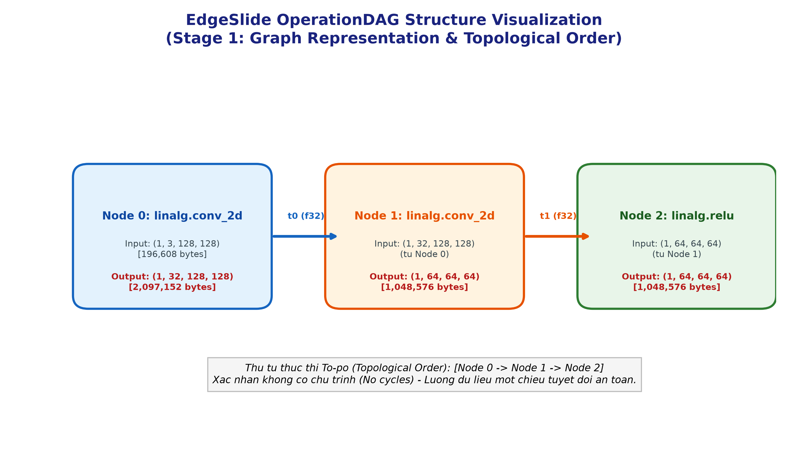

# CHI TIẾT INPUT / OUTPUT: `tests/test_dag.py` (STAGE 1)

Thư mục này phân tích chi tiết dữ liệu **Đầu vào (Input)** và **Đầu ra (Output)** của file test nền tảng đầu tiên: [`tests/test_dag.py`](file:///C:/Users/Acer/Downloads/edge_slide/tests/test_dag.py).

---

## 1. Sơ đồ Đồ thị DAG trực quan hóa (Output Image)
File ảnh đồ họa minh họa cấu trúc DAG được tự động sinh ra:

---

## 2. Bảng đối chiếu Input & Output của từng hàm Test

| Tên Test Case | Input (Đầu vào) | Logic Xử lý (Processing) | Output (Đầu ra) | Đánh giá |
| :--- | :--- | :--- | :--- | :---: |
| `test_tensor_info_size_bytes` | Tensor shape `(1, 64, 32, 32)`, dtype `f32` | $1 \times 64 \times 32 \times 32 \times 4\text<class 'bytes'>$ | `262,144 bytes` (256 KB) | ✅ PASS |
| `test_tensor_info_dynamic_bounds` | Tensor shape `(1, -1, 32, 32)`, bounds `                                                               1`, dtype `f16` | Thay `-1` bằng `64`, nhân với `2 bytes` | `131,072 bytes` (128 KB) | ✅ PASS |
| `test_add_node_and_edges` | Thêm 2 Node Conv và nối cạnh $0 \rightarrow 1$ | Cập nhật danh sách kề và danh sách consumers | `len(nodes) = 2`, `len(edges) = 1`, `consumers = [1]` | ✅ PASS |
| `test_topological_order_basic` | Đồ thị 3 node: Node 0 $\rightarrow$ Node 1 $\rightarrow$ Node 2 | Thuật toán Kahn (Kahn's Algorithm) | Thứ tự `[0, 1, 2]` (Node 0 chạy trước Node 1) | ✅ PASS |
| `test_topological_order_no_cycle` | Thêm cạnh nối tuần tự Matmul $\rightarrow$ Generic | Kiểm tra In-degree và phát hiện chu trình | Không có chu trình, thứ tự hợp lệ | ✅ PASS |

---

## 3. So sánh: Bản gốc PyTorch vs Bản EdgeSlide OperationDAG

| Tiêu chí | Bản PyTorch thông thường | Bản EdgeSlide (`OperationDAG`) | Ý nghĩa khoa học |
| :--- | :--- | :--- | :--- |
| **Biểu diễn mô hình** | Các lớp `nn.Module` lồng nhau, gọi hàm `forward()` ngầm định. | Chuyển thành Đồ thị có hướng chuẩn hóa (`OperationDAG`) gồm các Node và Cạnh. | Giúp trình biên dịch nhìn thấy toàn bộ bức tranh luồng dữ liệu trước khi chạy. |
| **Quản lý bộ nhớ** | PyTorch tự cấp phát động ở runtime (khó đoán trước bộ nhớ đỉnh). | Tính toán kích thước từng Tensor chính xác từng byte (`size_bytes`). | Biết trước Tensor nào sẽ làm tràn bộ nhớ SRAM để chuẩn bị cắt nhỏ (Tiling). |
| **Thứ tự thực thi** | Chạy tuần tự theo code Python. | Thuật toán Tô-pô (Kahn's Algorithm) xác định thứ tự tối ưu. | Đảm bảo tính toán đúng luồng dữ liệu, không bao giờ bị Deadlock hay vòng lặp. |

---
*Tài liệu và hình ảnh được tự động sinh bởi `run_io_test_dag.py` tại `verify code edge slice/IO test_dag`.*
